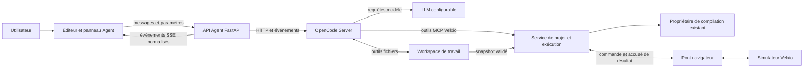
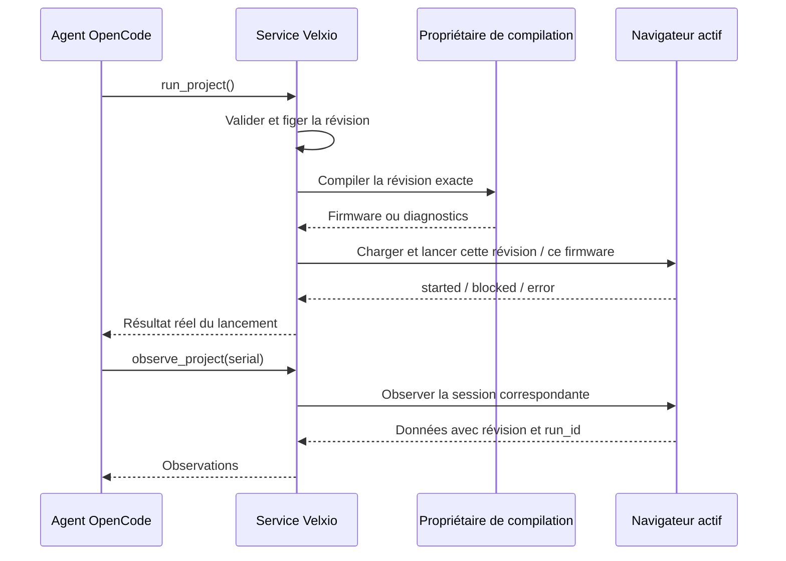

# Architecture proposée : agent IA connectable dans Velxio

Date : 3 novembre 2026. Statut : plan d’architecture, sans modification de l’application ni installation de moteur d’agent. Les noms d’API, de composants et de fichiers nouveaux ci-dessous sont proposés ; ils ne décrivent pas des fonctionnalités déjà livrées.

Mise à jour : une première version de ce plan est maintenant implémentée. Le [guide de l’agent connectable](agent-connectable.md) décrit son installation, son périmètre livré et ses vérifications. Le texte ci-dessous conserve la cible d’architecture initiale ; ACP, plusieurs harness et les captures restent des extensions.

## 1. Décision proposée

Intégrer un panneau de conversation dans l’éditeur et brancher **OpenCode en mode serveur** derrière FastAPI. L’utilisateur choisit son fournisseur, l’URL de son LLM et le modèle dans les paramètres. OpenCode prend en charge la conversation, les appels d’outils et le contexte. Velxio conserve la gestion du projet, de la compilation et de la simulation.

Cette recommandation résulte de la lecture du dépôt et des documentations officielles ; elle reste à confirmer par un prototype d’intégration. Aucune connexion entre OpenCode et Velxio n’a été exécutée pendant cette étude.

Le parcours attendu :

> Ouvrir un projet → connecter son modèle → demander une modification → voir les fichiers et le circuit évoluer → voir la simulation démarrer → laisser l’agent lire le résultat et corriger.

Le projet ouvert fournit implicitement le contexte. L’utilisateur et le modèle n’ont pas à reconstruire un tableau `files`, un document natif complet ou un identifiant à chaque action.

Deux connexions distinctes doivent être comprises par l’architecture :

| Connexion | Rôle | Exemple |
| --- | --- | --- |
| Fournisseur LLM | Héberge le modèle utilisé par le moteur | URL d’un serveur compatible, modèle, clé éventuelle |
| Moteur d’agent, ou harness | Gère conversation, contexte et exécution des outils | Instance OpenCode administrée par Velxio |

L’interface courante affiche les réglages du LLM. La connexion à un serveur OpenCode existant est une option avancée, avec des conditions d’accès aux fichiers précisées plus bas.

## 2. Ce qui existe dans ce dépôt

| Point d’appui vérifié | Conséquence pour l’implémentation |
| --- | --- |
| [EditorPage.tsx](../frontend/src/pages/EditorPage.tsx) contient un emplacement `data-velxio-slot="agent-chat"` réservé à l’overlay privé | Un point d’extension pour le chat existe ; prévoir un propriétaire unique du panneau dans les builds OSS et privés |
| [useCompileLogsStore.ts](../frontend/src/store/useCompileLogsStore.ts) centralise les logs | Réutiliser cette source pour le retour de compilation à l’agent |
| [editorCommands.ts](../frontend/src/lib/editorCommands.ts) expose `sim.compile`, `sim.run`, `sim.stop` et `project.connectAgent` | Les commandes existent, mais leur contrat retourne `void` : les déclencher ne constitue pas une preuve de réussite |
| [EditorToolbar.tsx](../frontend/src/components/editor/EditorToolbar.tsx) contient `handleRun`, la compilation et les vérifications avant lancement | Extraire une commande asynchrone commune au bouton et à l’agent pour éviter la divergence des parcours |
| [vlxFile.ts](../frontend/src/utils/vlxFile.ts) décrit le snapshot natif et charge les stores | Conserver `.vlx` comme format d’échange ; son import de fichier efface l’identité du projet courant et ne doit pas servir à chaque synchronisation de l’agent |
| [facade.py](../backend/app/mcp/compact/facade.py) expose six outils compacts | Réutiliser le catalogue, la validation et la persistance lorsque leurs contrats conviennent ; les six outils ne pilotent pas le navigateur |
| [server.py](../backend/app/mcp/server.py) possède un ancien `run_project` qui compile puis définit `simulation_ready` | Cette fonction ne fournit pas le lancement réel requis |
| [compile.py](../backend/app/api/routes/compile.py) et le propriétaire compact encadrent les builds | Faire passer la compilation de l’agent par le propriétaire existant, avec son admission et son contexte d’utilisateur |
| [hooks.py](../backend/app/core/hooks.py) fournit les points d’extension d’identité ; l’OSS ne comporte pas l’authentification de l’overlay | Définir explicitement le mode local mono-utilisateur et le mode hébergé authentifié |
| [main.py](../backend/app/main.py) monte le MCP sur `/` en dernier | Enregistrer les nouvelles routes avant ce montage final et composer correctement leur cycle de vie |

Le code OSS contient des références à un agent privé, mais son implémentation n’a pas été inspectée ici. Ce plan propose une intégration autonome, avec un branchement explicite pour l’overlay existant.

## 3. Peut-on réutiliser un harness ?

Oui. Trois options correspondent au besoin, avec des coûts d’intégration différents.

| Option | Capacités documentées | Adaptation à Velxio | Décision proposée |
| --- | --- | --- | --- |
| **OpenCode Server** | Serveur HTTP, sessions, événements SSE, fournisseurs configurables, outils MCP | Adaptateur HTTP depuis Python ; processus séparé avec accès au workspace | Premier choix pour un prototype rapide d’agent de code |
| **Pi SDK** | Sessions et outils accessibles depuis un SDK TypeScript ; modèles personnalisables | Petit service Node/Bun à héberger et API de connexion à fournir | Alternative si l’on veut intégrer le moteur plus directement dans un service TypeScript |
| **Deep Agents SDK** | Harness Python avec outils, contexte et backends de fichiers ; modèles avec appels d’outils | Intégration dans la pile Python, avec persistance et streaming à raccorder | Alternative si l’exploitation d’un processus OpenCode supplémentaire devient contraignante |

Sources primaires : [serveur OpenCode](https://opencode.ai/docs/server/), [MCP OpenCode](https://opencode.ai/docs/mcp-servers/), [SDK Pi](https://raw.githubusercontent.com/earendil-works/pi/main/packages/coding-agent/docs/sdk.md), [modèles Pi](https://raw.githubusercontent.com/earendil-works/pi/main/packages/coding-agent/docs/models.md), [présentation Deep Agents](https://docs.langchain.com/oss/python/deepagents/overview), [modèles Deep Agents](https://docs.langchain.com/oss/python/deepagents/models).

OpenCode est retenu pour son interface serveur déjà disponible et son fonctionnement d’agent de code. FastAPI peut la consommer avec `httpx`, déjà présent dans le backend. Son [SDK JavaScript](https://opencode.ai/docs/sdk/) existe, mais n’est pas nécessaire dans cette architecture. La [licence du dépôt consulté est MIT](https://raw.githubusercontent.com/anomalyco/opencode/dev/LICENSE) ; conserver les notices dans un futur paquet distribué.

Pi a changé d’emplacement : l’ancienne URL `badlogic/pi-mono` redirige vers `earendil-works/pi`. La documentation consultée utilise `@earendil-works/pi-coding-agent`. Vérifier et épingler les versions au prototype, sans reprendre un ancien exemple de paquet par automatisme.

**ACP comme extension ultérieure.** Un adaptateur ACP permettrait de connecter d’autres agents compatibles. ACP v1 spécifie actuellement `stdio` ; le transport distant Streamable HTTP est encore en spécification. Un branchement ACP demanderait donc un pont de processus côté backend, et ne correspond pas à coller une URL de LLM dans un champ. Ne pas le rendre obligatoire pour la première version. Source : [transports ACP](https://agentclientprotocol.com/protocol/transports).

La couche propre à Velxio reste petite : identité, configuration, workspace, traduction des événements et outils de simulation. La boucle modèle → outil → résultat est celle du harness.

## 4. Vue d’ensemble



Tout le trafic navigateur passe par l’API Velxio. Le serveur OpenCode n’est pas exposé directement au frontend. Le chemin de données pour une action de simulation est OpenCode → outil Velxio → propriétaire de compilation → navigateur → observations → résultat d’outil → OpenCode.

Responsabilités proposées :

| Module | Responsabilité |
| --- | --- |
| `AgentPanel` | Conversation, actions en cours, fichiers changés, état de simulation, bouton Arrêter |
| `AgentSettingsDialog` | Profils de connexion au LLM, test et choix du modèle |
| `AgentGateway` | Résoudre l’identité et le projet, démarrer un tour, relayer et conserver les événements |
| `HarnessAdapter` | Créer/reprendre une session, envoyer un message, écouter, interrompre, tester les capacités |
| `WorkspaceService` | Matérialiser les fichiers, valider les modifications et publier des révisions |
| `ProjectExecutionService` | Construire un snapshot exact, demander sa compilation et son lancement |
| `AgentBrowserBridge` | Appliquer une révision, lancer le simulateur et répondre avec des observations |

`AgentGateway` n’implémente ni raisonnement, ni boucle d’appels au LLM, ni résumé de contexte. Ces fonctions restent dans le harness.

## 5. Interface et paramètres

### Panneau de conversation

Panneau redimensionnable à droite, repliable ; sur écran étroit, vue dédiée alternant avec l’éditeur. L’en-tête affiche le projet courant, le modèle et l’état de connexion. Le corps montre les messages et des cartes d’actions compréhensibles : « Modifie sketch.ino », « Compile », « Démarre », « Lit la sortie série ».

Le panneau affiche les changements apportés et permet de restaurer un checkpoint de projet. Le compositeur accepte une demande et, si le modèle le permet, une image. Un bouton Arrêter reste accessible pendant l’exécution. Les identifiants techniques restent dans les détails des actions.

Ne monter qu’un fournisseur de panneau : nouveau panneau OSS activé par configuration, ou panneau fourni par l’overlay. Ajouter un contrat de fournisseur explicite ; ne pas monter un deuxième arbre de conversation sur le slot privé par effet de bord.

### Paramètres « IA »

| Champ | Comportement proposé |
| --- | --- |
| Activer l’agent | Fonction facultative ; l’éditeur fonctionne sans processus d’agent |
| Nom du profil | « Serveur local », « Modèle équipe », etc. |
| Protocole / fournisseur | Compatible Chat Completions pour le premier endpoint personnalisé ; autres adaptateurs selon la version testée |
| URL de base du LLM | URL d’API, avec exemple correspondant au protocole choisi |
| Modèle | Liste lorsque le fournisseur l’autorise, saisie manuelle toujours disponible |
| Clé API | Facultative pour un endpoint qui n’en exige pas ; champ masqué et remplacement explicite |
| Tester la connexion | Vérifie accessibilité, modèle, streaming et appel d’un outil sans effet |
| Capacités | Résultats du test : texte, outils, images ; états `vérifié`, `indisponible` ou `non testé` |
| Limites avancées | Durée d’un tour et maximum d’étapes du harness, adaptés aux capacités de sa version |

Une URL joignable ne prouve pas qu’un modèle sait appeler les outils. Le test doit réellement demander un appel à un outil de diagnostic sans effet, pas seulement interroger `/models`. L’échec du test laisse le profil modifiable et explique le problème. Les images restent optionnelles ; les erreurs de compilation et la sortie série suffisent pour une première boucle textuelle.

OpenCode documente les fournisseurs personnalisés avec `options.baseURL`, les modèles et les clés. L’adaptateur doit sélectionner le pilote adapté au protocole, plutôt que supposer que toutes les URL acceptent les mêmes requêtes. Source : [fournisseurs OpenCode](https://opencode.ai/docs/providers/).

Les changements de profil s’appliquent au prochain tour. Un tour déjà lancé conserve la révision de configuration avec laquelle il a démarré. Une configuration utilisateur n’écrit jamais dans la configuration globale d’autres utilisateurs.

### Où se trouve le LLM ?

Le LLM doit être joignable **depuis le processus OpenCode**. Le texte d’aide des paramètres doit rendre ce point clair.

| Déploiement | Signification de `localhost` dans l’URL du LLM |
| --- | --- |
| Velxio et OpenCode sur la machine de l’utilisateur | Cette machine |
| OpenCode dans Docker | Son conteneur ; employer un nom de service ou une adresse d’hôte configurée |
| Velxio hébergé sur un serveur distant | Le serveur distant, pas l’ordinateur qui affiche la page |

Première cible : installation locale / auto-hébergée. Pour joindre un modèle sur l’ordinateur de l’utilisateur depuis un Velxio distant, il faudra un connecteur local ou un endpoint réseau accessible. Un champ URL dans la page ne crée pas cet accès réseau.

## 6. Projet implicite et espace de fichiers

À la première demande, le frontend synchronise le projet ouvert, y compris les modifications non sauvegardées dans un compte. Le serveur crée un workspace possédé par la session utilisateur, puis matérialise les sources dans un dossier de travail. Il retourne un lien de session que le frontend conserve automatiquement.

Arborescence proposée, interne au serveur :

```text
agent-data/<owner>/<workspace>/
├── .velxio.json              # ID et mapping des groupes, gérés par Velxio
├── work/                    # fichiers de travail accessibles au harness
│   ├── sketch/sketch.ino
│   └── sketch/config.h
├── revisions/<hash>.vlx      # snapshots natifs validés et immuables
└── runs/<run-id>/            # résultats, logs et observations référencés
```

Les sessions du harness, sa configuration et les secrets résident dans un stockage distinct du dossier de code. Le fichier d’identité est généré et protégé des modifications de l’agent. L’ID relie bien le dossier au projet, comme demandé, mais l’autorisation vient de l’identité de session côté serveur.

Ne pas introduire un nouveau format de projet concurrent de `.vlx`. Les sources du dossier sont une copie de travail ; chaque publication reconstruit un snapshot natif complet. Le circuit est modifié via un outil typé et validé. Les groupes de fichiers et leurs associations aux cartes proviennent du manifeste généré.

Pour un nouveau projet, le service réutilise un starter ou un exemple valide. Le contrat `create_project` lie automatiquement ce nouveau projet à la conversation. Pour un projet existant, la conversation s’y attache sans en changer l’identité.

### Synchronisation et éditions concurrentes

1. Le frontend pousse ses modifications locales avant de lancer un tour ; l’accusé fixe `base_revision`.
2. Le harness travaille sur une copie issue de cette révision.
3. Les éditions terminées sont validées et publiées avec comparaison de version ; les événements alimentent l’éditeur et la vue des changements.
4. Une modification manuelle pendant le tour publie également une révision. Si la base de l’agent est périmée, conserver son diff et retourner `revision_conflict` ; aucune réécriture silencieuse de l’édition manuelle.
5. Avant chaque compilation, figer les fichiers et le circuit en un snapshot. `run` pointe sur son hash ; un changement ultérieur ne change pas ce qui est compilé.

Les événements de fichiers du harness servent à déclencher la réconciliation à la fin d’une opération. Un simple watcher lisant un fichier à moitié écrit ne publie pas une révision. Au prototype, vérifier les événements de fin d’outil de la version choisie ; sinon publier à la fin du tour et avant `run`, puis améliorer la granularité.

Une restauration crée une nouvelle révision à partir d’un checkpoint antérieur. Les instantanés des sources restent conservés ; les traces et artefacts dérivés peuvent suivre une rétention explicite.

## 7. Outils Velxio fournis au harness

OpenCode possède déjà ses outils de lecture et d’édition des fichiers. Ajouter une petite surface MCP spécialisée dans Velxio, attachée à la session. Les arguments de propriétaire, de workspace et de révision courante sont résolus côté serveur.

| Outil proposé | Entrée visible par le modèle | Résultat |
| --- | --- | --- |
| `create_project` | Carte ou exemple, nom facultatif | Starter créé et attaché, chemins des sources et résumé |
| `get_project` | Section facultative | Carte active, fichiers, circuit et capacités disponibles |
| `search_catalog` / `get_reference` | Contrats existants | Composants, broches et exemples issus du catalogue |
| `update_circuit` | Opérations typées sur instances et connexions | Validation, révision et diff du circuit |
| `run_project` | Aucun argument pour le projet actif ; carte facultative si plusieurs | ID d’exécution, révision, résultat de compilation et état réel du lancement |
| `observe_project` | Type d’observation et durée bornée | Sortie série, état, capture ou indisponibilité explicite |
| `stop_project` | Aucun argument pour l’exécution active | Arrêt confirmé ou état explicite |

L’agent n’envoie pas `files` ni `project_id` pour lancer le projet actif. L’infrastructure les connaît par sa liaison de session.

Un `run_project` long peut retourner un état en cours et un ID d’exécution. `observe_project` permet alors de consulter sa progression et son résultat ; la compilation ne recommence pas à chaque consultation. Les outils rendent des erreurs structurées que le harness peut utiliser pour corriger.

Cette nouvelle surface serait montée séparément, par exemple sous `/api/agent/tools/mcp`, avec un jeton court lié au workspace et au tour. Elle réutilise les services internes ; elle ne remplace pas discrètement le contrat à six outils du MCP compact. OpenCode accepte des serveurs MCP locaux et distants. Source : [configuration MCP OpenCode](https://opencode.ai/docs/mcp-servers/).

## 8. Lancement réel et boucle d’observation

Extraire progressivement de `EditorToolbar` une fonction partagée asynchrone de lancement, par exemple `executeProjectRun`. Le bouton et le pont de l’agent utilisent cette même fonction, avec résultats typés. Le registre actuel de commandes peut rester pour les menus ; son retour `void` ne suffit pas pour répondre à l’agent.

Séparer dans cette fonction la préparation, la demande de build et le chargement du firmware. Quand le service backend a déjà compilé la révision, le pont fournit le firmware correspondant avec son hash : le navigateur vérifie cette association et le charge sans déclencher une deuxième compilation. Le bouton manuel suit les mêmes étapes et réutilise seulement un firmware explicitement associé à la révision courante.



États minimaux d’exécution : `preparing`, `compiling`, `awaiting_browser`, `starting`, `running`, `blocked`, `error`, `stopped`, `interrupted`. `running` exige un accusé du moteur concerné. Un firmware compilé, un message envoyé au navigateur ou un délai écoulé ne suffisent pas.

Le pont conserve les vérifications électriques et les règles de disponibilité des cartes déjà présentes dans le parcours de lancement. Si le lancement requiert une décision déjà prévue par l’interface, retourner `blocked` et afficher cette décision dans le parcours existant. L’agent ne contourne pas automatiquement les vérifications.

Dans le MVP, une page d’éditeur connectée est nécessaire : les moteurs AVR/RP2040 s’exécutent dans le navigateur et les autres parcours comportent aussi un état frontend. Un navigateur absent retourne `browser_unavailable`. Un navigateur sans accusé dans le délai donne `browser_timeout`. Ne pas annoncer un mode sans navigateur à ce stade.

Pour plusieurs onglets, le serveur accorde une lease de simulation à un onglet pour le workspace. Les commandes comportent `command_id`, `run_id`, `revision` et une génération de lease. Une commande répétée est dédupliquée ; une réponse d’un ancien onglet est refusée. Une capture indique aussi ce qu’elle représente : canevas du circuit ou framebuffer du composant, et l’instant de capture.

Un statut `running` prouve le démarrage, pas la réussite fonctionnelle du programme. Le chat distingue « compilation réussie », « simulation démarrée » et « comportement observé ». Une validation visuelle exige un modèle compatible avec les images et une observation disponible.

Le bouton Arrêter interrompt le tour du harness et empêche de nouvelles actions. Il arrête également la simulation liée au tour si elle est active. Une compilation déjà admise suit la politique d’annulation/drain du propriétaire existant ; conserver son état réel si elle ne peut pas être interrompue immédiatement.

## 9. API et événements proposés

Toutes les routes sont relatives à FastAPI. Les IDs exposés par l’API sont manipulés par le frontend et l’adaptateur, automatiquement.

| Route | Rôle |
| --- | --- |
| `GET /api/agent/settings` | Profils publics, capacités et indication de présence d’une clé |
| `PUT /api/agent/settings` | Créer/modifier un profil appartenant à l’utilisateur |
| `POST /api/agent/settings/test` | Test court du modèle et d’un appel d’outil sans effet |
| `POST /api/agent/sessions` | Attacher/créer le workspace à partir du projet ouvert et de sa révision |
| `POST /api/agent/sessions/{id}/messages` | Admettre un message avec clé d’idempotence ; réponse immédiate avec ID de tour |
| `GET /api/agent/sessions/{id}/events` | Flux SSE normalisé, avec reprise par numéro d’événement |
| `POST /api/agent/sessions/{id}/stop` | Interrompre le tour et coordonner l’arrêt associé |
| `GET/PATCH /api/agent/workspaces/{id}` | Synchroniser snapshot et modifications avec comparaison de révision |
| `POST /api/agent/workspaces/{id}/restore` | Restaurer un checkpoint en créant une nouvelle révision |
| `WS /api/agent/browser/{workspace_id}` | Canal de commandes et résultats navigateur, authentifié et lié à la lease |
| `/api/agent/tools/mcp` | Outils spécialisés appelés par le harness |

Événements normalisés : `message.delta`, `message.completed`, `tool.started`, `tool.completed`, `workspace.changed`, `run.state`, `observation.available`, `turn.completed`, `turn.interrupted`, `error`. L’interface n’est pas couplée aux noms d’événements particuliers d’OpenCode.

Enveloppe commune : `event_id`, `session_id`, `turn_id`, `timestamp`, `type`, `payload` ; ajouter `revision` et `run_id` lorsque nécessaire. Une observation inclut sa borne de taille/durée et un marqueur de troncature. Les captures sont des artefacts référencés, pas du base64 répété dans le flux SSE.

Conserver un journal borné pour la reprise ; si le curseur demandé a expiré, retourner un état de resynchronisation et le dernier snapshot. Une reconnexion du chat n’admet pas une deuxième fois le message et ne redémarre pas un tour terminé.

L’adaptateur OpenCode s’appuie sur les API documentées de création de session, de message asynchrone, d’événements et d’interruption. Épingler une version et vérifier son OpenAPI `/doc` ; un événement SSE amont ne constitue pas, à lui seul, le journal rejouable Velxio. Source : [API du serveur OpenCode](https://opencode.ai/docs/server/).

## 10. Déploiement et configuration

### Première version locale / auto-hébergée

Ajouter un profil de déploiement facultatif pour l’agent. FastAPI supervise ou rejoint un processus OpenCode privé. Le processus a un volume de workspaces et un répertoire de configuration dédiés. Il reste distinct des compilateurs : OpenCode appelle l’outil de build Velxio et ne lance pas un deuxième service Arduino/ESP-IDF.

Le mode local sans comptes doit être explicitement mono-utilisateur, avec liaison privée ou authentification d’accès au proxy. Ne pas réutiliser la clé globale `anonymous` du store compact comme séparation entre visiteurs d’une installation publique.

### Mode hébergé avec comptes

Chaque workspace, session, secret, événement et artefact est lié au propriétaire résolu par les hooks existants. Avant toute ouverture publique, isoler les processus d’agent et leurs volumes par propriétaire ou par workspace ; un même processus possédant toutes les clés et tous les dossiers ne fournit pas cette séparation.

La configuration des fournisseurs est stockée séparément des projets. Les réponses de paramètres indiquent `has_api_key` et ne retournent pas la clé. En mode hébergé, utiliser un stockage de secrets avec chiffrement et clé maîtresse externe ; en local, privilégier le gestionnaire de secrets de la plateforme ou un fichier privé hors projet. Le navigateur peut transmettre une clé saisie, mais ne la conserve pas dans `localStorage` ni dans un `.vlx`.

Autoriser l’édition du code, le circuit, le build et la simulation dans le périmètre du projet sans confirmation répétée. Configurer explicitement les outils du harness : shell général, répertoires externes, installation de dépendances, publication et autres actions hors besoin ne sont pas des outils du MVP. Cette restriction d’outils complète l’isolation du processus ; elle ne la remplace pas. OpenCode fournit des règles de permissions `allow`, `ask`, `deny`. Source : [permissions OpenCode](https://opencode.ai/docs/permissions/).

Les paramètres de connexion acceptent uniquement des protocoles réseau pris en charge, sans exécution de commandes de configuration ni sélection arbitraire de paquets/plugins. En hébergement public, les endpoints personnalisés sont soumis à une politique réseau définie par l’administrateur ; en installation locale, l’accès au LLM du LAN doit être pris en charge explicitement. Les clés ne sont jamais transmises à une autre origine lors d’une redirection.

### Connexion à un OpenCode existant

Prévoir `managed` et `external` dans le contrat d’adaptateur. Dans le premier cas, Velxio gère le moteur ; dans le second, il teste l’adresse, l’authentification, la version et l’accès au workspace.

**Une URL de harness et un ID ne transfèrent pas les fichiers.** Le premier mode externe ne fonctionne que si OpenCode et Velxio partagent le dossier de travail à un chemin convenu. Un moteur sur une autre machine nécessite un connecteur de synchronisation : fonctionnalité ultérieure, distincte d’un simple réglage d’URL. Les secrets et événements du serveur externe restent associés à son propriétaire ; ne pas brancher un serveur global non cloisonné à plusieurs comptes.

## 11. Découpage de fichiers suggéré

Créer les modules suivants progressivement, sans migrer toute l’application pour le prototype :

```text
frontend/src/components/agent/
  AgentPanel.tsx
  AgentSettingsDialog.tsx
  AgentActionCard.tsx
frontend/src/services/agentService.ts
frontend/src/store/useAgentStore.ts
frontend/src/hooks/useAgentBrowserBridge.ts
frontend/src/services/projectExecution.ts
backend/app/api/routes/agent.py
backend/app/agent/
  contracts.py
  gateway.py
  settings.py
  workspace.py
  execution.py
  browser_bridge.py
  tools.py
  adapters/base.py
  adapters/opencode.py
```

Modifier `EditorPage.tsx` pour le fournisseur de panneau, `EditorMenuBar.tsx` et `editorCommands.ts` pour les paramètres, puis `EditorToolbar.tsx` pour déléguer au service partagé. Réutiliser les stores et sérialiseurs existants, sans les exposer au harness. Monter les routes dans `main.py` avant le montage MCP final et fermer proprement les sessions au shutdown.

En OSS, prévoir une persistance légère optionnelle des profils, liaisons de sessions et événements ; les snapshots peuvent réutiliser les primitives de `ProjectStore` avec un namespace propriétaire explicite. L’overlay peut fournir son stockage via un contrat dédié. Ne pas supposer que ses routes privées existent en auto-hébergement.

## 12. Plan de réalisation et critères de passage

| Étape | Livrable | Critère observable |
| --- | --- | --- |
| **0. Prototype du harness** | Version OpenCode épinglée, endpoint personnalisé, workspace d’essai et outil Velxio minimal | Un prompt modifie un fichier, appelle l’outil et termine ; streaming, interruption, reprise et limites vérifiés |
| **1. Connexion et chat** | Panneau, profils LLM, test de capacités, stockage privé des clés | Connexion à un endpoint local et à un endpoint distant compatible ; erreur lisible si outils indisponibles |
| **2. Projet synchronisé** | Workspace implicite, fichiers matérialisés, snapshots, diff et conflit de révision | L’agent modifie le projet ouvert ; une modification manuelle concurrente est conservée |
| **3. Boucle réelle sur une carte** | Compilation et lancement communs au bouton et à l’agent, accusé navigateur, série | Depuis un starter Uno et LED, l’agent modifie le sketch, lance et récupère la série ; une erreur introduite est détectée puis corrigée |
| **4. Circuit et observations** | Modifications typées du circuit, captures et capacités par carte | Composant et fil valides ajoutés ; capture reliée à la bonne exécution ; absence de vision signalée |
| **5. Exploitation** | Redémarrage, reconnexion, rétention et isolation selon le déploiement | Pas de duplication de tour/build, états interrompus explicites, absence de mélange entre comptes |
| **6. Extensions** | Autres cartes, harness externe partagé, éventuellement ACP | Chaque ajout valide le même contrat de workspace, d’événements et d’exécution |

Le prototype de l’étape 0 doit précéder l’interface complète. Il vérifie notamment la combinaison exacte : URL personnalisée + modèle avec outils + MCP Velxio + accès aux fichiers + arrêt. En cas de friction majeure, comparer le même scénario avec Deep Agents Python ; le contrat du frontend reste identique.

L’Uno est proposé pour le premier parcours : une carte, un sketch, une LED et la série. Ce choix ne suppose pas que sa toolchain soit installée ici ; la disponibilité sera vérifiée au début du prototype. La présence d’une carte au catalogue ne vaut pas capacité de build ou de simulation.

### Vérifications nécessaires pendant l’implémentation

- Contrats de l’adaptateur testés contre la version du harness épinglée ; endpoint compatible qui fonctionne et endpoint qui refuse les appels d’outils.
- Erreurs d’authentification, modèle absent, perte de connexion et streaming interrompu sans perte du projet ni redémarrage implicite du tour.
- Tour lié au bon projet, groupes de fichiers conservés, version `.vlx` inchangée et conflit d’édition sans écrasement.
- Démarrage du moteur réellement confirmé ; firmware obsolète, carte bloquée, navigateur absent et mauvais onglet refusés explicitement.
- Scénario de bout en bout avec une compilation réelle, lancement et observation série ; une compilation seule ne valide pas ce scénario.
- Bouton Arrêter, shutdown et reprise après incident : compilations et simulations conservent leurs états réels.
- Aucun secret dans exports, événements, logs ou réponses de paramètres ; accès croisé aux sessions et captures refusé en mode hébergé.
- Régressions ciblées sur le bouton Run, l’import/export `.vlx`, les groupes de fichiers et l’overlay de panneau.

## 13. Périmètre du premier livrable

Un utilisateur ouvre Velxio auto-hébergé, configure **URL du LLM + modèle + clé éventuelle**, teste la connexion et demande : « Fais clignoter la LED et affiche son état sur le port série. » Le chat modifie le projet, démarre la simulation visible et montre la série correspondante. L’utilisateur peut modifier le code et reprendre la conversation sur ce même projet.

Le moteur retenu est OpenCode, sous réserve du prototype. Le développement propre à Velxio porte sur le raccordement au projet et à sa simulation. Le support de plusieurs harness, l’exécution sans navigateur et le connecteur distant de fichiers viennent après cette boucle complète.
